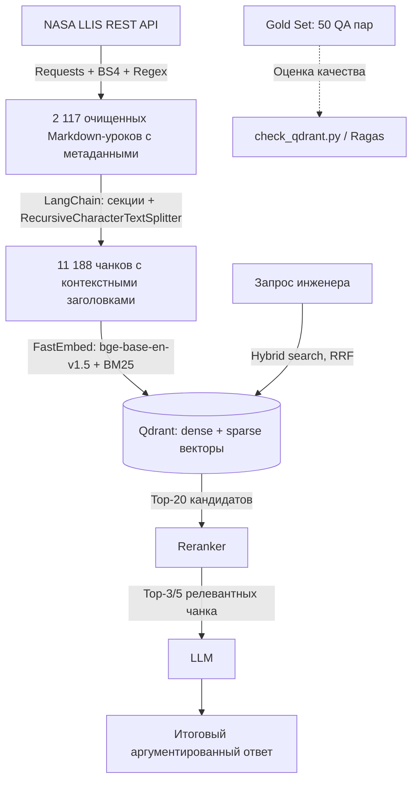

# 🚀 AeroRAG: Advanced RAG по базе инженерных инцидентов NASA (LLIS)

> **Интеллектуальная система поиска и анализа инженерных инцидентов, отказов оборудования и рекомендаций NASA на базе архитектуры Advanced RAG.**

[](https://www.python.org/)
[](https://llis.nasa.gov/)
[](https://qdrant.tech/)
[](https://www.langchain.com/)
[](./gold_set_50.csv)
[]()

---

## 📌 О проекте

При проектировании космических аппаратов, ракетных двигателей и стартовых комплексов критически важно не повторять прошлых ошибок. NASA ведет официальную базу технических расследований — **NASA Lessons Learned Information System (LLIS)**. В ней задокументированы тысячи реальных аварий, отказов и выводов экспертных комиссий (миссии *Curiosity*, *James Webb Space Telescope (JWST)*, *SMAP*, *МКС*, стартовые комплексы *KSC* и т.д.).

**Цель проекта AeroRAG:**
Создать production-grade RAG-систему, позволяющую инженеру на естественном языке мгновенно находить первопричины поломок оборудования, прецеденты аналогичных аварий и проверенные инженерные предписания NASA.

---

## 🏗 Архитектура и технологический стек



### Сводная таблица стека

| Этап (*Stage*) | Технология (*Choice*) | Обоснование (*Why*) | Статус |
| :--- | :--- | :--- | :---: |
| **1. Ingestion** | `Requests`, `BeautifulSoup4`, `Regex` | NASA API возвращает JSON с HTML внутри; BS4 и Regex очищают HTML без разрыва списков и таблиц. | ✅ |
| **2. Chunking** | `LangChain` (`langchain-text-splitters`) | Деление по секциям урока + рекурсивная нарезка длинных секций; в каждом чанке заголовок урока и секции. | ✅ |
| **3. Embeddings** | `BAAI/bge-base-en-v1.5` (dense) + `Qdrant/bm25` (sparse) через `FastEmbed` | Сильная открытая модель для английского, ONNX-инференс на CPU без PyTorch; BM25 ловит точные шифры и номера стандартов. | ✅ |
| **4. Vector DB & Search** | `Qdrant 1.19` в Docker + `langchain-qdrant` | Нативные dense + sparse векторы и гибридный поиск (RRF) в одной коллекции, фильтрация по payload-индексам. | ✅ |
| **5. Reranking** | Cross-Encoder (напр. `bge-reranker-base`) | Отсекает ложные срабатывания, оставляет топ-3–5 фрагментов. | ⏳ |
| **6. Generation** | LLM (выбор на следующем этапе) | Генерация ответа строго по найденному контексту со ссылками на уроки. | ⏳ |
| **7. Evaluation** | Gold Set 50 + `check_qdrant.py`, далее `Ragas` | Hit@k / MRR ретривера сейчас; *Faithfulness*, *Context Recall* после подключения LLM. | ⚙️ |

---

## 🛠 Что реализовано

### Phase 1 — данные и бенчмарк
1. **Парсинг всей базы LLIS** ([llis_scraper.py](llis_scraper.py)): запросы к Elasticsearch API с детерминированной сортировкой `[{"lesson_date": "desc"}, {"_id": "asc"}]`, повторы при сетевых ошибках. Из 2 135 записей сохранено **2 117 уроков**, 18 пустых отбраковано.
2. **Очистка HTML → Markdown:** списки `<ul>/<ol>`, таблицы, индексы (`H_2O`, `10^6`), HTML-сущности (`&deg;` → `°`), фильтрация заглушек (`None`, `N/A`, `TBD`).
3. **Метаданные:** `lesson_id`, `title`, `date`, `year`, `org_code`, `categories`, `url` и структура `## Abstract / Driving Event / Lesson Learned / Recommendation`.
4. **Gold Set 50** ([generate_gold_set.py](generate_gold_set.py)): 50 вопросов на английском с точными ответами, цитатой-подтверждением (`Context_Quote`) и ссылкой на урок. Экспорт в CSV (UTF-8 BOM), JSON, Markdown.

### Phase 2 — обработанный датасет и Qdrant
5. **Чанкинг** ([build_chunks.py](build_chunks.py)):
   * урок делится по смысловым секциям — чанк не смешивает «что случилось» и «что рекомендовано»;
   * длинные секции режутся `RecursiveCharacterTextSplitter` (1 200 символов, перекрытие 150);
   * в начало каждого чанка добавляется `[NASA LLIS #id] Название` + `Section: ...`;
   * отбрасываются заглушки (`See attached PDF`, `See Lessons Learned`, `[D]`) и обрывки без слов, куски короче 200 символов приклеиваются к соседнему чанку;
   * детерминированный ID чанка `<lesson_id>:<section>:<index>` → UUID точки в Qdrant, поэтому повторная индексация не создает дублей;
   * все 50 цитат Gold Set целиком лежат внутри одного чанка.
6. **Qdrant** ([docker-compose.yml](docker-compose.yml), [qdrant_store.py](qdrant_store.py), [index_qdrant.py](index_qdrant.py)):
   * коллекция `nasa_llis`: вектор `dense` (768, cosine) + вектор `sparse` (BM25, IDF на стороне Qdrant);
   * payload-индексы по `lesson_id`, `org_code`, `section`, `categories`, `year` для фильтрации;
   * доступ через LangChain `QdrantVectorStore` в режимах `DENSE`, `SPARSE`, `HYBRID`.
7. **Проверка** ([check_qdrant.py](check_qdrant.py)): состояние коллекции, демо-запросы, оценка ретривера на Gold Set.

---

## 📊 Характеристики датасета

* **Объем:** 2 117 уроков (вся база LLIS), период **1972–2025**.
* **Центры NASA:** KSC 481 · JPL 419 · JSC 236 · HQ 206 · MSFC 200 · GSFC 145 · ARC 119 · GRC 116 · LARC 101 · прочие (NESC, AFRC, SSC, WSTF, IVV, WFF) 95.
* **Заполненность секций:** Driving Event 98% · Lesson Learned 99% · Recommendation 98% · Abstract 48% (в старых уроках аннотации нет).
* **Длина урока:** медиана 2 367 символов (~590 токенов), максимум 53 408.

**Чанки** (`llis_chunks.jsonl`):
* **11 188 чанков** из 2 116 уроков (исключен тестовый урок #1937 с текстом «This is only a test»);
* по секциям: Driving Event 5 258 · Lesson Learned 2 444 · Recommendation 2 401 · Abstract 1 085;
* длина: медиана ~690 символов, максимум ~1 550 (укладывается в лимит 512 токенов bge-base).

---

## 🎯 Качество поиска на Gold Set

Оценка ретривера `check_qdrant.py` на 50 вопросах Gold Set (11 188 чанков, top-10, CPU):

| Режим | Lesson Hit@1 | Lesson Hit@5 | Lesson Hit@10 | Quote Hit@5 | MRR@10 | мс/запрос |
| :--- | :---: | :---: | :---: | :---: | :---: | :---: |
| Dense (`bge-base-en-v1.5`) | 0.92 | 0.98 | 0.98 | 0.96 | 0.95 | 39 |
| Sparse (BM25) | 0.96 | 1.00 | 1.00 | 0.98 | 0.98 | 9 |
| **Hybrid (RRF)** | **0.96** | **1.00** | **1.00** | **1.00** | 0.97 | 38 |

* **Lesson Hit@k** — нужный урок есть среди top-k чанков; **Quote Hit@k** — найден именно чанк с эталонной цитатой; **MRR@10** — средний обратный ранг первого чанка нужного урока.
* Hybrid — единственный режим, который для всех 50 вопросов находит чанк с цитатой в top-5. Dense промахивается на Q21, BM25 — на одной цитате.
* **Ограничение:** вопросы Gold Set составлены по тексту уроков и лексически близки к нему, поэтому BM25 здесь особенно силен, а метрики близки к потолку. Для реальных запросов инженеров (перефразированных, без терминов из отчета) ожидаемо ниже; для различения моделей и реранкера понадобится набор более сложных вопросов.
* Score в гибридном режиме — это оценка RRF (по рангам), а не косинусная близость.

---

## 📂 Структура репозитория

```text
NASA_RAG/
├── llis_scraper.py       # Сбор и очистка всей базы NASA LLIS -> llis_full.json/.jsonl
├── llis_full.json(l)     # [Датасет] 2 117 очищенных уроков с метаданными
├── llis_all_1000.json(l) # [Архив] первая выгрузка 1 000 уроков (Phase 1)
├── inspect_dataset.py    # Статистика датасета
│
├── build_chunks.py       # Чанкинг (LangChain) -> llis_chunks.jsonl
├── llis_chunks.jsonl     # [Обработанный датасет] 11 188 чанков, готовых к индексации
├── rag_loader.py         # Загрузка уроков и чанков как LangChain Document
│
├── docker-compose.yml    # Qdrant v1.19.2
├── qdrant_store.py       # Конфигурация коллекции, эмбеддинги, LangChain QdrantVectorStore
├── index_qdrant.py       # Индексация чанков в Qdrant
├── check_qdrant.py       # Проверка коллекции и оценка поиска на Gold Set
├── retrieval_eval.json   # Результаты последней оценки
│
├── generate_gold_set.py  # Генератор и верификатор Gold Set
├── gold_set_50.csv/json/md
└── requirements.txt
```

---

## 🚀 Быстрый старт

```bash
# 1. Окружение
python -m venv venv
venv\Scripts\activate            # Linux/Mac: source venv/bin/activate
pip install -r requirements.txt

# 2. Qdrant (нужен Docker Desktop)
docker compose up -d             # дашборд: http://localhost:6333/dashboard

# 3. Данные (готовые файлы уже в репозитории, шаги можно пропустить)
python llis_scraper.py           # вся база LLIS -> llis_full.json
python build_chunks.py           # -> llis_chunks.jsonl

# 4. Индексация (~30 мин на CPU; при первом запуске скачиваются модели ~0.5 ГБ)
python index_qdrant.py --recreate

# 5. Проверка и оценка
python check_qdrant.py
```

### Использование в коде
```python
from qdrant_store import get_vector_store, field_filter

store = get_vector_store()  # гибридный поиск: bge-base + BM25, RRF
docs = store.similarity_search(
    "Why did the hydraulic pressure gauge rupture?",
    k=5,
    filter=field_filter("org_code", "KSC"),
)
for d in docs:
    print(d.metadata["lesson_id"], d.metadata["section"], d.metadata["url"])

retriever = store.as_retriever(search_kwargs={"k": 20})  # для RAG-цепочки LangChain
```

---

## 📈 Roadmap

- [x] Сбор всей базы NASA LLIS (2 117 уроков) через REST API
- [x] Предобработка текста в Markdown и обогащение метаданными
- [x] Создание и валидация 50 эталонных QA-пар (Gold Set)
- [x] Чанкинг по секциям в LangChain
- [x] Qdrant в Docker, dense (`bge-base-en-v1.5`) + sparse (BM25) векторы
- [x] Гибридный поиск (RRF) и оценка ретривера на Gold Set
- [ ] Подключение реранкера (Cross-Encoder)
- [ ] Выбор LLM и RAG-цепочка генерации ответов со ссылками на уроки
- [ ] Автоматический расчет метрик Ragas (*Faithfulness*, *Answer Relevance*, *Context Recall*)
