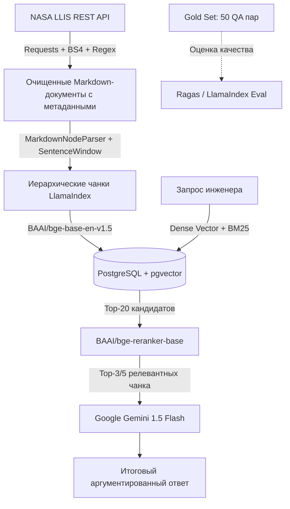

# 🚀 AeroRAG: Advanced RAG по базе инженерных инцидентов NASA (LLIS)

> **Интеллектуальная система поиска и анализа инженерных инцидентов, отказов оборудования и рекомендаций NASA на базе архитектуры Advanced RAG.**

[](https://www.python.org/)
[](https://llis.nasa.gov/)
[](./gold_set_50.csv)
[]()

---

## 📌 О проекте

При проектировании космических аппаратов, ракетных двигателей и стартовых комплексов критически важно не повторять прошлых ошибок. NASA ведет официальную базу технических расследований — **NASA Lessons Learned Information System (LLIS)**. В ней задокументированы сотни реальных аварий, отказов и выводов экспертных комиссий (миссии *Curiosity*, *James Webb Space Telescope (JWST)*, *SMAP*, *МКС*, стартовые комплексы *KSC* и т.д.).

**Цель проекта AeroRAG:**  
Создать production-grade RAG-систему, позволяющую инженеру на естественном языке мгновенно находить первопричины поломок оборудования, прецеденты аналогичных аварий и проверенные инженерные предписания NASA.

---

## 🏗 Архитектура и технологический стек

Архитектура системы построена по методологии **Advanced RAG** с гибридным поиском, реранкингом и оценкой качества:



### Сводная таблица стека

| Этап (*Stage*) | Выбранная технология (*Choice*) | Обоснование выбора (*Why*) | Статус в проекте |
| :--- | :--- | :--- | :---: |
| **1. Ingestion** | `Python`, `Requests`, `BeautifulSoup4`, `Regex` | NASA API возвращает JSON; BS4 и Regex глубоко очищают HTML без разрыва списков и таблиц. | **Реализовано** ✅ |
| **2. Chunking** | `LlamaIndex` (`MarkdownNodeParser`, `SentenceWindowNodeParser`) | Деление по секциям инцидента; оконный парсер связывает точный факт с расширенным контекстом. | **Готово к интеграции** ⚙️ |
| **3. Embeddings** | `BAAI/bge-base-en-v1.5` (локально через HuggingFace) | Топовая открытая модель для английского языка на MTEB бенчмарке, бесплатная, локальный запуск. | **В плане (Phase 2)** ⏳ |
| **4. Storage & Search** | `PostgreSQL` + `pgvector` (Hybrid with BM25) | Векторный семантический поиск + полнотекстовый BM25 по точным инженерным шифрам и номерам стандартов. | **В плане (Phase 2)** ⏳ |
| **5. Reranking** | `BAAI/bge-reranker-base` (Cross-Encoder) | Отсекает ложные срабатывания, фильтрует контекст и оставляет топ-3–5 самых релевантных фрагментов. | **В плане (Phase 2)** ⏳ |
| **6. Generation** | `Google Gemini 1.5 Flash` | Быстрая генерация с опорой на контекст, 1M+ токенов окна, бесплатный доступ через Google AI Studio. | **В плане (Phase 2)** ⏳ |
| **7. Evaluation** | `Ragas` + **Gold Set (50 QA пар)** | Проверка метрик *Context Recall*, *Context Precision* и фактологичности (*Faithfulness*) по эталону. | **Бенчмарк готов** ✅ |

---

## 🛠 Что уже реализовано (Текущий этап / Phase 1)

1. **Парсинг и детерминированная пагинация:**
   * Написан модульный парсер к Elasticsearch API базы NASA LLIS ([llis_scraper.py](llis_scraper.py)).
   * Выгружено ровно **1 000 самых актуальных отчетов** (2000–2025 гг.) со всех ключевых центров NASA (`KSC`, `JPL`, `MSFC`, `JSC`, `ARC`, `GSFC` и др.).
2. **Глубокая очистка данных (HTML → Markdown Pipeline):**
   * Преобразование списков `<ul>` и `<ol>` в валидный Markdown (`- `, `1. `) без потери структуры.
   * Конвертация таблиц `<table>` в синтаксис Markdown таблиц.
   * Форматирование инженерных индексов (`H_2O`, `10^6`), декодирование сущностей (`&deg;` → `°`, `&plusmn;` → `±`, `&reg;` → `®`).
   * Полная фильтрация артефактов и заглушек (`"None"`, `"N/A"`, `\xa0`, дубликаты пробелов).
3. **Обогащение метаданными:**
   * Каждый урок структурирован заголовками (`## Driving Event`, `## Lesson Learned`, `## Recommendation`) и содержит метаданные: `lesson_id`, `title`, `date`, `year`, `org_code`, `categories`, `url`.
4. **Эталонный датасет для валидации (Gold Set 50):**
   * Сформировано **50 эталонных вопросов на английском языке** по грамматическим правилам (Wh-words, инверсия глаголов).
   * Ко всем вопросам даны **прямые, неизмененные фактологические ответы** из датасета с подтверждением точной цитатой (`Context_Quote`) и ссылкой на первоисточник.
   * Экспортировано в **CSV (UTF-8 BOM для Google Таблиц)**, **JSON** и **Markdown**.

---

## 📂 Структура репозитория

```text
NASA_RAG/
│
├── llis_scraper.py       # [Основной скрипт] Сборщик и препроцессор NASA LLIS
├── llis_all_1000.json    # [Датасет] 1 000 подготовленных документов (полный JSON)
├── llis_all_1000.jsonl   # [Датасет] Тот же датасет в формате JSON Lines для стриминга
│
├── gold_set_50.csv       # [Gold Set] 50 QA-пар для Google Таблиц (с цитатами и ссылками)
├── gold_set_50.json      # [Gold Set] 50 QA-пар в формате JSON для фреймворка Ragas
├── gold_set_50.md        # [Gold Set] Подробный Markdown-отчет с разбором каждого вопроса
├── generate_gold_set.py  # [Скрипт] Генератор и верификатор Gold Set по датасету
│
├── rag_loader.py         # [Утилита] Загрузчик документов в LangChain / LlamaIndex
├── inspect_dataset.py    # [Аналитика] Быстрая проверка качества и статистики датасета
└── README.md             # [Документация] Описание архитектуры и инструкция
```

### Подробное описание файлов

* **[`llis_scraper.py`](llis_scraper.py):** Сердце этапа сбора данных. Делает запросы к API с сортировкой `[{"lesson_date": "desc"}, {"_id": "asc"}]`, чтобы избежать дубликатов при пагинации. Преобразует HTML в чистый Markdown и валидирует наличие полезной информации.
* **[`gold_set_50.csv`](gold_set_50.csv):** Готовая таблица для проверки домашнего задания. Содержит колонки: `Question_ID`, `Question`, `Ground_Truth_Answer`, `Context_Quote`, `Lesson_ID`, `NASA_Center`, `Document_Title`, `Section`, `Category`, `Review_Notes`, `Source_URL`.
* **[`rag_loader.py`](rag_loader.py):** Готовый модуль интеграции. Предоставляет функцию `to_langchain_documents()`, которая конвертирует очищенные JSON-файлы в объекты `Document(page_content=..., metadata=...)` для сплиттеров LlamaIndex/LangChain.
* **[`inspect_dataset.py`](inspect_dataset.py):** Утилита для терминала, рассчитывающая статистику наполненности секций, охват по годам и распределение токенов.

---

## 📊 Характеристики подготовленного датасета

* **Объем:** 1 000 уникальных уроков NASA.
* **Период инцидентов:** с 2000 по 2025 год.
* **Распределение по космическим центрам:**
  * Kennedy Space Center (`KSC`): **237**
  * Jet Propulsion Laboratory (`JPL`): **182**
  * Marshall Space Flight Center (`MSFC`): **98**
  * Johnson Space Center (`JSC`): **98**
  * Ames Research Center (`ARC`): **96**
  * Goddard Space Flight Center (`GSFC`): **78**
  * Прочие центры (`SSC`, `LARC`, `GRC`, `HQ`): **211**
* **Заполненность смысловых секций:**
  * `Driving Event` (что произошло): **97.9%**
  * `Lesson Learned` (выводы комиссии): **98.4%**
  * `Recommendation` (предписания): **98.2%**
  * `Abstract` (аннотация): **78.0%**
* **Длина документов:** медиана — **2 859 символов** (~714 токенов).

---

## 🚀 Быстрый старт

### 1. Установка зависимостей
```bash
python -m venv venv
# Активация: venv\Scripts\activate (Windows) или source venv/bin/activate (Linux/Mac)
pip install requests beautifulsoup4
```

### 2. Сбор данных и предобработка
```bash
python llis_scraper.py
```
*Скрипт скачает 1 000 свежих уроков NASA и создаст файлы `llis_all_1000.json` и `llis_all_1000.jsonl`.*

### 3. Проверка статистики датасета
```bash
python inspect_dataset.py llis_all_1000.json
```

### 4. Генерация / валидация Gold Set
```bash
python generate_gold_set.py
```
*Сгенерирует файлы `gold_set_50.csv`, `gold_set_50.json` и `gold_set_50.md`.*

### 5. Использование в коде RAG
```python
from rag_loader import to_langchain_documents

# Загрузка 1 000 документов с метаданными одной строкой:
documents = to_langchain_documents("llis_all_1000.json")

print(f"Загружено документов: {len(documents)}")
print("Пример метаданных:", documents[0].metadata)
```

---

## 📈 План развития (Roadmap / Phase 2)

- [x] Сбор 1 000 отчетов NASA LLIS через REST API
- [x] Качественная предобработка текста в Markdown и обогащение метаданными
- [x] Создание и валидация 50 эталонных QA-пар (Gold Set)
- [ ] Развертывание PostgreSQL с расширением `pgvector` в Docker
- [ ] Настройка иерархического чанкинга (`MarkdownNodeParser` + `SentenceWindowNodeParser`) в LlamaIndex
- [ ] Генерация эмбеддингов через локальную модель `bge-base-en-v1.5`
- [ ] Настройка гибридного поиска (Reciprocal Rank Fusion: BM25 + pgvector)
- [ ] Подключение реранкера `bge-reranker-base`
- [ ] Интеграция LLM Google Gemini 1.5 Flash для генерации ответов
- [ ] Автоматический расчет метрик Ragas (*Faithfulness*, *Answer Relevance*, *Context Recall*)
