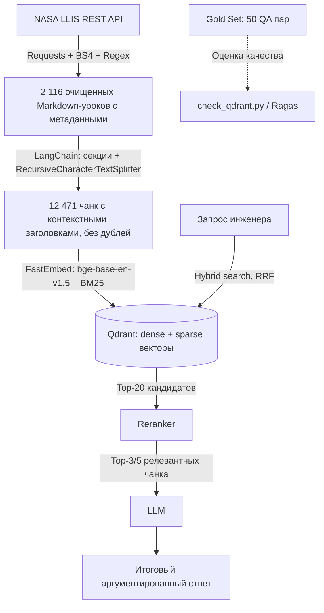

# Houston: Advanced RAG по базе инженерных инцидентов NASA (LLIS)

> *«Houston, we have a problem»* — а Houston отвечает: такое уже случалось, вот урок NASA и что было сделано.

> **Интеллектуальная система поиска и анализа инженерных инцидентов, отказов оборудования и рекомендаций NASA на базе архитектуры Advanced RAG.**

[](https://www.python.org/)
[](https://llis.nasa.gov/)
[](https://qdrant.tech/)
[](https://www.langchain.com/)
[](./gold_set_50.csv)
[]()

---

## О проекте

При проектировании космических аппаратов, ракетных двигателей и стартовых комплексов критически важно не повторять прошлых ошибок. NASA ведет официальную базу технических расследований — **NASA Lessons Learned Information System (LLIS)**. В ней задокументированы тысячи реальных аварий, отказов и выводов экспертных комиссий (миссии *Curiosity*, *James Webb Space Telescope (JWST)*, *SMAP*, *МКС*, стартовые комплексы *KSC* и т.д.).

**Цель проекта Houston:**
Создать production-grade RAG-систему, позволяющую инженеру на естественном языке мгновенно находить первопричины поломок оборудования, прецеденты аналогичных аварий и проверенные инженерные предписания NASA.

> Учебный некоммерческий проект. Не связан с NASA и не одобрен ею; используются открытые данные NASA LLIS.

---

## Коротко: что в проекте и где лежит

Проект — это конвейер из шагов. Каждый шаг — отдельный скрипт, который читает файл предыдущего шага и пишет свой:

```text
API NASA LLIS
  -> llis_scraper.py  -> llis_full.json     (очищенные уроки)
  -> build_chunks.py  -> llis_chunks.jsonl  (чанки для поиска)
  -> index_qdrant.py  -> Qdrant             (векторная база)
  -> check_qdrant.py  + gold_set_*.json     -> метрики качества поиска
```

**Код**

| Файл | Что делает |
| :--- | :--- |
| `llis_scraper.py` | Скачивает всю базу NASA LLIS через API, чистит HTML в Markdown, раскладывает урок по секциям, собирает метаданные |
| `build_chunks.py` | Режет уроки на фрагменты (чанки) по секциям, добавляет к каждому заголовок урока, убирает дубли, проверяет лимит 512 токенов |
| `qdrant_store.py` | Общие настройки: адрес Qdrant, модели эмбеддингов, схема коллекции, функция `get_vector_store()` для поиска |
| `index_qdrant.py` | Считает векторы чанков (смысловой bge-base и BM25) и загружает их в Qdrant |
| `check_qdrant.py` | Проверяет коллекцию, показывает демо-запросы, считает качество поиска на Gold Set |
| `generate_gold_set.py`, `generate_gold_set_hard.py` | Хранят эталонные вопросы с ответами и проверяют, что каждая цитата-ответ есть в данных |
| `rag_loader.py` | Загрузка уроков и чанков в виде LangChain `Document` |
| `inspect_dataset.py` | Быстрая статистика датасета |

**Данные**

| Файл | Что внутри | Зачем |
| :--- | :--- | :--- |
| `llis_full.json` | 2 116 очищенных уроков: секции, метаданные, полный текст в Markdown | Главный датасет, из него строится все остальное |
| `llis_chunks.jsonl` | 12 471 чанк: текст фрагмента + метаданные, по строке на чанк | Обработанный датасет, который загружается в Qdrant |
| `gold_set_50.json` (+ `.csv`, `.md`) | 50 эталонных вопросов с ответами и цитатами (2010–2025 гг.) | Основной бенчмарк; CSV — таблица для проверки, MD — отчет |
| `gold_set_hard.json` | 50 трудных перефразированных вопросов (1990–2009 гг.) | Бенчмарк, на котором видны слабые места поиска |
| `retrieval_eval.json`, `retrieval_eval_hard.json` | Метрики последней оценки поиска | История качества |

**Конфигурация:** `docker-compose.yml` (запуск Qdrant), `requirements.txt` (библиотеки Python).

**Не хранится в репозитории** (создается командами из раздела «Быстрый старт»): `venv/` (окружение Python), `.fastembed_cache/` (модели эмбеддингов, ~0.5 ГБ), `qdrant_storage/` (файлы базы Qdrant), `llis_raw.json` (сырой ответ API для повторной обработки без скачивания).

---

## Архитектура и технологический стек



### Сводная таблица стека

| Этап (*Stage*) | Технология (*Choice*) | Обоснование (*Why*) | Статус |
| :--- | :--- | :--- | :---: |
| **1. Ingestion** | `Requests`, `BeautifulSoup4`, `Regex` | NASA API возвращает JSON с HTML внутри; BS4 и Regex очищают HTML без разрыва списков и таблиц. | готово |
| **2. Chunking** | `LangChain` (`langchain-text-splitters`) | Деление по секциям урока + рекурсивная нарезка длинных секций; в каждом чанке заголовок урока и секции. | готово |
| **3. Embeddings** | `BAAI/bge-base-en-v1.5` (dense) + `Qdrant/bm25` (sparse) через `FastEmbed` | Сильная открытая модель для английского, ONNX-инференс на CPU без PyTorch; BM25 ловит точные шифры и номера стандартов. | готово |
| **4. Vector DB & Search** | `Qdrant 1.19` в Docker + `langchain-qdrant` | Нативные dense + sparse векторы и гибридный поиск (RRF) в одной коллекции, фильтрация по payload-индексам. | готово |
| **5. Reranking** | Cross-Encoder (напр. `bge-reranker-base`) | Отсекает ложные срабатывания, оставляет топ-3–5 фрагментов. | в планах |
| **6. Generation** | LLM (выбор на следующем этапе) | Генерация ответа строго по найденному контексту со ссылками на уроки. | в планах |
| **7. Evaluation** | Gold Set 50 + `check_qdrant.py`, далее `Ragas` | Hit@k / MRR ретривера сейчас; *Faithfulness*, *Context Recall* после подключения LLM. | частично |

---

## Что реализовано

### Phase 1 — данные и бенчмарк
1. **Парсинг всей базы LLIS** ([llis_scraper.py](llis_scraper.py)): запросы к Elasticsearch API с детерминированной сортировкой `[{"lesson_date": "desc"}, {"_id": "asc"}]`, повторы при сетевых ошибках. Из 2 135 записей сохранено **2 116 уроков**, 19 пустых или тестовых отбраковано. Сырой ответ API сохраняется в `llis_raw.json`, повторная обработка без обращения к API: `python llis_scraper.py --from-raw llis_raw.json`.
2. **Очистка HTML → Markdown:** вложенные списки `<ul>/<ol>` (пустые пункты отбрасываются), таблицы, индексы (`H_2O`, `10^6`), HTML-сущности (`&deg;` → `°`). Переносы строк задают только теги, как в браузере; битая разметка из базы NASA нормализуется (`</br>`, `</</TD>`, курсив вплотную к слову, потерянные кавычки `quot`, «Â¹»). Заглушки (`None`, `N/A`, `See attached PDF`, `See Lessons Learned`, `Click here to view…`) удаляются.
3. **Секции и метаданные:**
   * секции `Abstract`, `Driving Event`, `Lesson Learned`, `Recommendation`, `Evidence of Recurrence Control Effectiveness` (что сделано после урока) и `Related Documents and Policy` (нормативы вроде NPR 7120.5 — их хорошо находит BM25);
   * у части уроков текст в API продублирован в двух полях разной полноты (`drivingEvent`/`description_event`, `lesson`/`lesson_learned`): берется более полная версия, а действительно разные тексты объединяются;
   * метаданные: `lesson_id`, `title`, `date`, `year`, `org_code`, `program`, `program_phase`, `categories` (написание «&»/«and» унифицировано), `keywords`, `attachments` (названия и ссылки на вложения), `url`;
   * 12 уроков без названия в API («None») получают название из первой фразы текста (`title_derived: true`);
   * уроки с полностью совпадающим текстом помечаются `duplicate_of`.
4. **Gold Set 50** ([generate_gold_set.py](generate_gold_set.py)): 50 вопросов на английском с точными ответами, цитатой-подтверждением (`Context_Quote`) и ссылкой на урок. Экспорт в CSV (UTF-8 BOM), JSON, Markdown.

### Phase 2 — обработанный датасет и Qdrant
5. **Чанкинг** ([build_chunks.py](build_chunks.py)):
   * урок делится по смысловым секциям — чанк не смешивает «что случилось» и «что рекомендовано»;
   * длинные секции режутся `RecursiveCharacterTextSplitter` (1 200 символов, перекрытие 150);
   * в начало каждого чанка добавляется `[NASA LLIS #id] Название` + `Section: ...`;
   * обрывки без слов отбрасываются, куски короче 200 символов приклеиваются к соседнему чанку;
   * длина проверяется токенизатором bge-base: ни один чанк не превышает 512 токенов, модель ничего не обрезает;
   * одинаковый текст хранится одним чанком: повторы секций внутри урока сливаются всегда, а между уроками — только длинные фрагменты (от 300 символов; например, 45 уроков о закупках комиссии CAIB с одинаковым текстом). Все вхождения перечислены в `lesson_ids` и `sections`;
   * детерминированный ID чанка `<lesson_id>:<section>:<index>` → UUID точки в Qdrant, поэтому повторная индексация не создает дублей;
   * все 50 цитат Gold Set целиком лежат внутри одного чанка.
6. **Qdrant** ([docker-compose.yml](docker-compose.yml), [qdrant_store.py](qdrant_store.py), [index_qdrant.py](index_qdrant.py)):
   * коллекция `nasa_llis`: вектор `dense` (768, cosine) + вектор `sparse` (BM25, IDF на стороне Qdrant);
   * payload-индексы по `lesson_id`, `lesson_ids`, `org_code`, `section`, `sections`, `categories`, `program`, `keywords`, `year` для фильтрации;
   * доступ через LangChain `QdrantVectorStore` в режимах `DENSE`, `SPARSE`, `HYBRID`.
7. **Проверка** ([check_qdrant.py](check_qdrant.py)): состояние коллекции, демо-запросы, оценка ретривера на Gold Set.

---

## Характеристики датасета

* **Объем:** 2 116 уроков (вся база LLIS), период **1972–2025**.
* **Центры NASA:** KSC 481 · JPL 418 · JSC 236 · HQ 206 · MSFC 200 · GSFC 145 · ARC 119 · GRC 116 · LARC 101 · прочие (NESC, AFRC, SSC, WSTF, IVV, WFF) 94.
* **Заполненность секций:** Driving Event 98% · Lesson Learned 98% · Recommendation 96% · Abstract 48% · Evidence 42% · References 16%.
* **Дополнительные метаданные:** программа у 424 уроков, фаза программы у 387, ключевые слова у 101, вложения у 92.
* **Длина урока:** медиана 2 670 символов (~670 токенов), максимум 53 524.

**Чанки** (`llis_chunks.jsonl`):
* **12 471 чанк** из 2 116 уроков; 308 одинаковых копий слиты, 255 чанков относятся сразу к нескольким урокам;
* по секциям: Driving Event 5 275 · Lesson Learned 2 424 · Recommendation 2 379 · Abstract 1 075 · Evidence 1 014 · References 304;
* длина: медиана ~660 символов / 135 токенов, максимум 490 токенов (лимит модели 512).

**Известные ограничения исходных данных** (исправить на нашей стороне нельзя):
* у 1 620 уроков (в основном 1990–2000-х) NASA не указала категории (`["None"]`), фильтр по `categories` охватывает только ~24% базы;
* дата `1999-02-01` стоит у 184 уроков, похоже на дату массовой загрузки в систему, а не дату события — фильтр по году для старых уроков неточен;
* аннотация (`Abstract`) есть только у 48% уроков.

---

## Качество поиска на Gold Set

Оценка ретривера `check_qdrant.py` на 50 вопросах Gold Set (12 471 чанк, top-10, CPU):

| Режим | Lesson Hit@1 | Lesson Hit@5 | Lesson Hit@10 | Quote Hit@5 | MRR@10 | мс/запрос |
| :--- | :---: | :---: | :---: | :---: | :---: | :---: |
| Dense (`bge-base-en-v1.5`) | 0.92 | 0.98 | 0.98 | 0.96 | 0.95 | 53 |
| Sparse (BM25) | 0.96 | 1.00 | 1.00 | 0.98 | 0.98 | 17 |
| **Hybrid (RRF)** | **0.98** | **1.00** | **1.00** | **1.00** | **0.98** | 58 |

* **Lesson Hit@k** — нужный урок есть среди top-k чанков (с учетом `lesson_ids` слитых чанков); **Quote Hit@k** — найден именно чанк с эталонной цитатой; **MRR@10** — средний обратный ранг первого чанка нужного урока.
* Hybrid — лучший режим по всем метрикам: для всех 50 вопросов находит чанк с цитатой в top-5. Dense промахивается на Q21, BM25 — на одной цитате.
* После исправлений качества данных (дедупликация, полные тексты секций, чистка разметки) Hybrid Hit@1 вырос с 0.96 до 0.98, MRR@10 — с 0.97 до 0.98.
* **Ограничения бенчмарка:** вопросы Gold Set составлены по тексту уроков 2010–2025 гг. и лексически близки к нему, поэтому BM25 здесь особенно силен, а метрики близки к потолку. Уроки 1990–2000-х (~81% базы) и вопросы по секциям Lesson Learned / Recommendation / Evidence в наборе почти не представлены. Поэтому добавлен Hard Gold Set (см. ниже).
* Score в гибридном режиме — это оценка RRF (по рангам), а не косинусная близость.

### Hard Gold Set (`gold_set_hard`, 50 вопросов)

`generate_gold_set_hard.py` → `gold_set_hard.json`. Набор дополняет `gold_set_50` (формат тот же, плюс поля `filter`, `relevant_lesson_ids` и `lexical_overlap`):

* все 50 вопросов по урокам **1990–2009** гг. (20 из 1990-х, 30 из 2000-х), 13 центров;
* ответы в секциях **Recommendation (18), Lesson Learned (17), Evidence (9), References (5)** и Driving Event (1);
* вопросы **перефразированы** так, как их задал бы инженер, без аббревиатур и терминов отчета («self-igniting propellants» вместо *hypergolic*, «squib» вместо *NASA Standard Initiator*). Доля значимых слов вопроса, которые дословно есть в цитате, в среднем 0.14 (максимум 0.40);
* **14 вопросов с фильтром**: `org_code` (KSC, JSC, SSC, AFRC, GRC, GSFC, MSFC, ARC) или `program` (Mars Phoenix, MSL, LRO, Cassini, MER, ISS program);
* **5 вопросов, ответ на которые есть в нескольких уроках** (`relevant_lesson_ids`): потеря Mars Climate Orbiter, Mars Polar Lander, зеркало Hubble, test-as-you-fly (10 уроков), requirements creep (7 уроков). Засчитывается любой из уроков;
* генератор проверяет каждую цитату: она дословно есть в `full_text` урока и в указанной секции, целиком лежит в одном чанке `llis_chunks.jsonl`, у которого в `metadata.lesson_ids` есть этот урок; фильтр совпадает с метаданными урока. При ошибке скрипт завершается с ошибкой.

```bash
python generate_gold_set_hard.py
python check_qdrant.py --eval-only --gold gold_set_hard.json   # -> retrieval_eval_hard.json
```

| Режим | Lesson Hit@1 | Lesson Hit@5 | Lesson Hit@10 | Quote Hit@5 | Quote Hit@10 | MRR@10 | мс/запрос |
| :--- | :---: | :---: | :---: | :---: | :---: | :---: | :---: |
| Dense (`bge-base-en-v1.5`) | 0.60 | 0.82 | 0.88 | 0.70 | 0.76 | 0.68 | 46 |
| Sparse (BM25) | 0.66 | 0.86 | 0.90 | 0.48 | 0.58 | 0.73 | 23 |
| **Hybrid (RRF)**, среднее 5 прогонов | **0.68** | **0.89** | **0.94** | **0.71** | **0.82** | **0.77** | 47 |

Lesson Hit@5 / MRR@10 по срезам (Hybrid — один прогон):

| Срез | n | Dense | Sparse | Hybrid |
| :--- | :---: | :---: | :---: | :---: |
| Recommendation | 18 | 0.89 / 0.75 | 0.83 / 0.68 | 0.89 / 0.74 |
| Lesson Learned | 17 | 0.82 / 0.67 | 0.82 / 0.71 | 0.88 / 0.80 |
| Evidence | 9 | 0.78 / 0.60 | 0.89 / 0.83 | 0.89 / 0.81 |
| References | 5 | 0.80 / 0.80 | 1.00 / 0.77 | 0.80 / 0.73 |
| С фильтром | 14 | 0.93 / 0.85 | 0.93 / 0.89 | 0.93 / 0.89 |
| Без фильтра | 36 | 0.78 / 0.62 | 0.83 / 0.67 | 0.86 / 0.73 |
| Несколько уроков | 5 | 0.60 / 0.47 | 0.80 / 0.64 | 0.80 / 0.64 |

**Выводы:**

* Набор заметно труднее: Hybrid Hit@1 падает с 0.96–0.98 до ~0.68, MRR@10 — с 0.97 до ~0.77. Метрики далеко от потолка, поэтому на этом наборе можно сравнивать эмбеддинги и реранкер.
* **Hybrid по-прежнему лучший режим** по Lesson Hit@5/@10 и MRR. Он теряет урок в top-10 только на 3 вопросах (Q8, Q25, Q50); Dense теряет 6, BM25 — 5. Промахи Dense и BM25 почти не пересекаются (у обоих только Q50), поэтому RRF их взаимно компенсирует.
* **BM25 находит урок, но не тот чанк:** Lesson Hit@5 = 0.86, а Quote Hit@5 = 0.48. Без общих слов с вопросом BM25 вытягивает чанк заголовка или Abstract того же урока, а не секцию Recommendation или Evidence с ответом. Dense точнее попадает в нужную секцию (Quote Hit@5 = 0.70). Это главный аргумент за реранкер поверх top-k на уровне чанков.
* **Dense сильнее на Recommendation**, BM25 сильнее на Evidence и References: там ответ — названия миссий, номера документов (APR 8000.1, NPD 8710.3A, DCP-S-009) и числа. Это лексические совпадения даже в перефразированном вопросе.
* **Фильтры** по центру или программе заметно облегчают поиск (Hit@5 0.93 против 0.78–0.86 без фильтра). Но поле `program` в LLIS заполнено непоследовательно: например, «Lunar Reconnaissance Orbiter» и «Lunar Reconnaissance Orbiter TWTA». Точный `MatchValue` пропускает варианты написания, и для реальных запросов понадобится нормализация программ.
* **Вопросы с несколькими уроками** — самая слабая группа (Hybrid MRR@10 0.64; Dense 0.47). Обобщающий вопрос («что говорят разборы программ о росте требований») попадает в общие уроки по управлению проектами, а не в конкретные.
* **Hybrid недетерминирован:** при равных RRF-оценках порядок чанков меняется от прогона к прогону. Поэтому Hit@1 на Hard Set колеблется в пределах 0.66–0.70, MRR@10 — 0.76–0.78, а на `gold_set_50` Hit@1 — 0.96–0.98. Dense и Sparse стабильны. Для сравнения моделей усредняйте несколько прогонов или задайте детерминированный tie-break.

---

## Структура репозитория

```text
Houston/
├── llis_scraper.py       # Сбор и очистка всей базы NASA LLIS -> llis_full.json
├── llis_full.json        # [Датасет] 2 116 очищенных уроков с метаданными
├── llis_raw.json         # Сырой ответ API (не в git, создается скрейпером)
├── inspect_dataset.py    # Статистика датасета
│
├── build_chunks.py       # Чанкинг (LangChain) -> llis_chunks.jsonl
├── llis_chunks.jsonl     # [Обработанный датасет] 12 471 чанк, готовый к индексации
├── rag_loader.py         # Загрузка уроков и чанков как LangChain Document
│
├── docker-compose.yml    # Qdrant v1.19.2
├── qdrant_store.py       # Конфигурация коллекции, эмбеддинги, LangChain QdrantVectorStore
├── index_qdrant.py       # Индексация чанков в Qdrant
├── check_qdrant.py       # Проверка коллекции и оценка поиска на Gold Set
├── retrieval_eval.json   # Результаты последней оценки на gold_set_50
├── retrieval_eval_hard.json # Результаты последней оценки на gold_set_hard
│
├── generate_gold_set.py  # Генератор и верификатор Gold Set
├── gold_set_50.csv/json/md
├── generate_gold_set_hard.py # Генератор и верификатор Hard Gold Set (1990–2009, перефразированные вопросы)
├── gold_set_hard.json
└── requirements.txt
```

---

## Быстрый старт

```bash
# 1. Окружение
python -m venv venv
venv\Scripts\activate            # Linux/Mac: source venv/bin/activate
pip install -r requirements.txt

# 2. Qdrant (нужен Docker Desktop)
docker compose up -d             # дашборд: http://localhost:6333/dashboard

# 3. Данные (готовые файлы уже в репозитории, шаги можно пропустить)
python llis_scraper.py           # вся база LLIS -> llis_full.json
python build_chunks.py           # -> llis_chunks.jsonl

# 4. Индексация (~35 мин на CPU; при первом запуске скачиваются модели ~0.5 ГБ)
python index_qdrant.py --recreate

# 5. Проверка и оценка
python check_qdrant.py
```

### Использование в коде
```python
from qdrant_store import get_vector_store, field_filter

store = get_vector_store()  # гибридный поиск: bge-base + BM25, RRF
docs = store.similarity_search(
    "Why did the hydraulic pressure gauge rupture?",
    k=5,
    filter=field_filter("org_code", "KSC"),
)
for d in docs:
    print(d.metadata["lesson_id"], d.metadata["section"], d.metadata["url"])

# Только рекомендации (поле sections учитывает и слитые одинаковые секции)
recs = store.similarity_search("cryogenic line venting", k=5, filter=field_filter("sections", "recommendation"))

retriever = store.as_retriever(search_kwargs={"k": 20})  # для RAG-цепочки LangChain
```

---

## Roadmap

- [x] Сбор всей базы NASA LLIS (2 116 уроков) через REST API
- [x] Предобработка текста в Markdown и обогащение метаданными
- [x] Создание и валидация 50 эталонных QA-пар (Gold Set)
- [x] Чанкинг по секциям в LangChain
- [x] Qdrant в Docker, dense (`bge-base-en-v1.5`) + sparse (BM25) векторы
- [x] Гибридный поиск (RRF) и оценка ретривера на Gold Set
- [x] Hard Gold Set: трудные перефразированные вопросы по урокам 1990–2009 гг.
- [ ] Гибридный поиск с запасом кандидатов в каждой ветви (сейчас LangChain берет по k из dense и BM25 до слияния)
- [ ] Подключение реранкера (Cross-Encoder)
- [ ] Выбор LLM и RAG-цепочка генерации ответов со ссылками на уроки
- [ ] Автоматический расчет метрик Ragas (*Faithfulness*, *Answer Relevance*, *Context Recall*)
