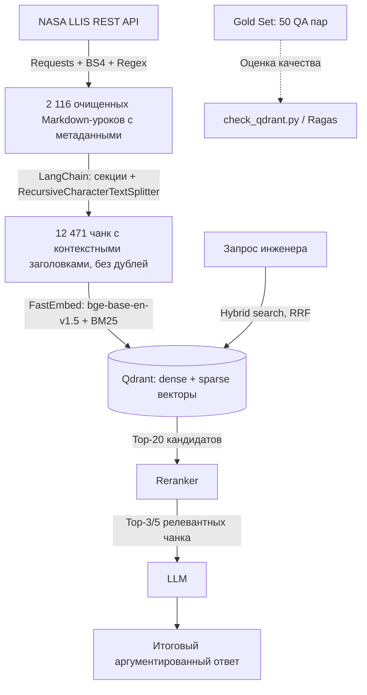

# Houston: Advanced RAG по базе инженерных инцидентов NASA (LLIS)

> *«Houston, we have a problem»* — а Houston отвечает: такое уже случалось, вот урок NASA и что было сделано.

> **Интеллектуальная система поиска и анализа инженерных инцидентов, отказов оборудования и рекомендаций NASA на базе архитектуры Advanced RAG.**

[](https://www.python.org/)
[](https://llis.nasa.gov/)
[](https://qdrant.tech/)
[](https://www.langchain.com/)
[](./data/benchmarks/gold_set_50.csv)
[]()

---

## О проекте

При проектировании космических аппаратов, ракетных двигателей и стартовых комплексов критически важно не повторять прошлых ошибок. NASA ведет официальную базу технических расследований — **NASA Lessons Learned Information System (LLIS)**. В ней задокументированы тысячи реальных аварий, отказов и выводов экспертных комиссий (миссии *Curiosity*, *James Webb Space Telescope (JWST)*, *SMAP*, *МКС*, стартовые комплексы *KSC* и т.д.).

**Цель проекта Houston:**
Создать production-grade RAG-систему, позволяющую инженеру на естественном языке мгновенно находить первопричины поломок оборудования, прецеденты аналогичных аварий и проверенные инженерные предписания NASA.

> Учебный некоммерческий проект. Не связан с NASA и не одобрен ею; используются открытые данные NASA LLIS.

---

## Коротко: что в проекте и где лежит

Проект — это конвейер из шагов. Каждый шаг — отдельный скрипт, который читает файл предыдущего шага и пишет свой:

```text
API NASA LLIS
  -> llis_scraper.py  -> llis_full.json     (очищенные уроки)
  -> build_chunks.py  -> llis_chunks.jsonl  (чанки для поиска)
  -> index_qdrant.py  -> Qdrant             (векторная база)
  -> check_qdrant.py  + gold_set_*.json     -> метрики качества поиска
  -> retriever.py     -> контекст для LLM   (обработка запроса, гибрид, реранкер, отбор контекста)
  -> eval_retriever.py / tune_top_k.py      -> вклад каждого этапа поиска, подбор Top-K
  -> rag/chain.py     -> ответ Mistral      (промпт, контекст, ссылки [LLIS #id], история диалога)
  -> eval_rag.py      -> качество ответов   (ссылки, отказы, Ragas)
```

**Код**

| Файл | Что делает |
| :--- | :--- |
| `llis_scraper.py` | Скачивает всю базу NASA LLIS через API, чистит HTML в Markdown, раскладывает урок по секциям, собирает метаданные |
| `build_chunks.py` | Режет уроки на фрагменты (чанки) по секциям, добавляет к каждому заголовок урока, убирает дубли, проверяет лимит 512 токенов |
| `qdrant_store.py` | Общие настройки: адрес Qdrant, модели эмбеддингов, схема коллекции, функция `get_vector_store()` для поиска |
| `index_qdrant.py` | Считает векторы чанков (смысловой bge-base и BM25) и загружает их в Qdrant |
| `check_qdrant.py` | Проверяет коллекцию, показывает демо-запросы, считает качество поиска на Gold Set |
| `retrieval/config.py` | Все параметры поиска (`RetrieverConfig`): режим, Top-K, реранкер, отбор контекста; базовая линия `BASELINE` |
| `retrieval/search.py` | Семантический, BM25 и гибридный поиск напрямую через Query API Qdrant (RRF / DBSF, отдельный `prefetch_k`) |
| `retrieval/query_processing.py` | Нормализация вопроса, словарь аббревиатур NASA из данных, подсказки-фильтры (центр, период, номер урока), варианты названий программ |
| `retrieval/reranker.py` | Переранжирование кандидатов Cross-Encoder'ом `BAAI/bge-reranker-base` (FastEmbed, ONNX, CPU) |
| `retrieval/context.py` | Отбор контекста: порог реранкера, группировка по урокам, соседние секции урока, бюджет токенов, текст с метками `[LLIS #id]` |
| `retrieval/retriever.py` | `HoustonRetriever` — весь конвейер поиска как LangChain `BaseRetriever`; CLI для ручной проверки |
| `eval_retriever.py`, `tune_top_k.py` | Оценка вклада каждого этапа поиска на обоих Gold Set; подбор `candidate_k`, `final_k` и порога реранкера |
| `rag/llm.py` | Подключение Mistral (`ChatMistralAI`), ключ из `.env`, повторы при 429 / 5xx |
| `rag/prompts.py` | Промпт ответа (только по контексту, ссылки `[LLIS #id]`, фиксированный отказ) и промпт переформулировки вопроса |
| `rag/citations.py` | Проверка ссылок в ответе, удаление ссылок вне контекста, список источников из метаданных, `RAGResponse` |
| `rag/chain.py` | `HoustonRAG` — LCEL-цепочка: переформулировка → поиск → контекст → Mistral → проверка ссылок |
| `rag/memory.py` | `ConversationalRAG` — история диалога по сессиям, окно последних сообщений, сохранение в JSON |
| `rag/ask.py` | CLI: один вопрос или диалог `--chat` |
| `eval_rag.py` | Оценка ответов на обоих Gold Set и вопросах вне базы; метрики Ragas с Mistral-судьей |
| `generate_gold_set.py`, `generate_gold_set_hard.py` | Хранят эталонные вопросы с ответами и проверяют, что каждая цитата-ответ есть в данных |
| `rag_loader.py` | Загрузка уроков и чанков в виде LangChain `Document` |
| `inspect_dataset.py` | Быстрая статистика датасета |

**Данные**

| Файл | Что внутри | Зачем |
| :--- | :--- | :--- |
| `data/processed/llis_full.json` | 2 116 очищенных уроков: секции, метаданные, полный текст в Markdown | Главный датасет, из него строится все остальное |
| `data/processed/llis_chunks.jsonl` | 12 471 чанк: текст фрагмента + метаданные, по строке на чанк | Обработанный датасет, который загружается в Qdrant |
| `data/benchmarks/gold_set_50.json` (+ `.csv`, `.md`) | 50 эталонных вопросов с ответами и цитатами (2010–2025 гг.) | Основной бенчмарк; CSV — таблица для проверки, MD — отчет |
| `data/benchmarks/gold_set_hard.json` | 50 трудных перефразированных вопросов (1990–2009 гг.) | Бенчмарк, на котором видны слабые места поиска |
| `data/processed/abbreviations.json` | 643 аббревиатуры NASA с расшифровками, собранные из текстов уроков | Раскрытие аббревиатур в запросе к BM25 |
| `data/evaluation/retrieval_eval.json`, `data/evaluation/retrieval_eval_hard.json` | Метрики последней оценки поиска | История качества |
| `data/evaluation/retriever_eval_*.json`, `top_k_tuning_*.json` | Результаты `eval_retriever.py` и `tune_top_k.py` | Сравнение этапов поиска и выбор Top-K |
| `data/benchmarks/out_of_scope.json` | 12 вопросов, ответа на которые в LLIS нет (5 общих, 7 о чужих космических миссиях; отсутствие проверено по текстам) | Проверка, что модель честно отказывается, а не отвечает из своих знаний |
| `data/evaluation/rag_answers_*.jsonl`, `rag_eval.json` | Ответы RAG с источниками и контекстом; сводные метрики | Качество генерации |

**Конфигурация:** `infra/docker-compose.yml` (запуск Qdrant), `requirements.txt` (библиотеки Python), `requirements-eval.txt` (Ragas, необязательно), `.env.example` (шаблон `.env` с ключом Mistral).

**Тесты:** `tests/` (pytest, работают без Qdrant-сервера и без скачивания моделей).

**Не хранится в репозитории** (создается командами из раздела «Быстрый старт»): `venv/` (окружение Python), `.fastembed_cache/` (модели эмбеддингов и реранкера, ~1.5 ГБ), `qdrant_storage/` (файлы базы Qdrant), `data/raw/llis_raw.json` (сырой ответ API для повторной обработки без скачивания).

---

## Архитектура и технологический стек

В проекте используется Python-конвейер подготовки данных и гибридного поиска: NASA LLIS → очистка → чанки → эмбеддинги → Qdrant → оценка найденных фрагментов. Ниже зафиксирован фактически реализованный стек. Версии Python-библиотек указаны по `requirements.txt`, версия сервера — по `infra/docker-compose.yml`.

| Компонент | Технология | Роль в проекте и причина использования |
| :--- | :--- | :--- |
| Язык | Python, заявленная поддержка 3.10+ | Обработка текстов, команды подготовки данных, индексация и оценка в одной кодовой базе. |
| Окружение и зависимости | `venv`, `pip`, `requirements.txt` | Изолированное окружение и явно закреплённые версии прямых зависимостей. |
| HTTP-запросы | Requests 2.34.2 | Загрузка записей NASA LLIS через API с обработкой повторных запросов. |
| HTML-парсинг | BeautifulSoup4 4.15.0 | Разбор HTML уроков перед преобразованием в очищенный текст с Markdown-разметкой. |
| Представление документов | LangChain Core 1.6.10 | Единый объект `Document` для текста, идентификатора и метаданных. |
| Разбиение текста | LangChain Text Splitters 1.1.3 | Рекурсивное разбиение длинных секций с перекрытием, чтобы сохранить контекст. |
| Проверка токенов | Hugging Face `tokenizers` | Подсчёт токенов чанков токенизатором BGE; импортируется напрямую, но отдельная версия в `requirements.txt` пока не закреплена. |
| Вычисление эмбеддингов | FastEmbed 0.9.0 | Локальное построение векторов через ONNX; текущий сценарий рассчитан на CPU. |
| Семантическая модель | `BAAI/bge-base-en-v1.5` | Англоязычные dense-векторы размерности 768 для поиска по смыслу. |
| Лексическая модель | `Qdrant/bm25` | Sparse-поиск для терминов, аббревиатур и номеров; IDF учитывается на стороне Qdrant. |
| Векторная база | Qdrant 1.19.2 | Хранение обоих типов векторов и метаданных, фильтрация и гибридный поиск с объединением рангов RRF. |
| Клиент базы | qdrant-client 1.19.1 | Создание коллекции, payload-индексов и обращение к серверу. |
| Интеграция поиска | langchain-qdrant 1.1.0 | Доступ к Qdrant как к `QdrantVectorStore`, режимы dense, sparse и hybrid. |
| Запуск инфраструктуры | Docker и Docker Compose | Воспроизводимый запуск сервера Qdrant с постоянным томом данных. |
| Форматы хранения | JSON, JSONL, CSV, Markdown | JSON для уроков и метрик, JSONL для чанков, CSV и Markdown для просмотра бенчмарка. |
| Оценка качества | Собственные Python-скрипты, два Gold Set по 50 вопросов | Проверка цитат и расчёт Lesson Hit@k, Quote Hit@k, MRR@10 и времени поиска. |
| Управление исходниками | Git и GitHub | История изменений, совместная работа и хранение кода, документации и подготовленных наборов. |

Такое сочетание уже используется в коде: BGE находит близкие по смыслу фрагменты, BM25 дополняет его точными совпадениями, а Qdrant объединяет результаты. Отдельные модули подготовки и оценки позволяют менять поиск и проверять его на одних и тех же вопросах.

Реранкер (Cross-Encoder `BAAI/bge-reranker-base` через FastEmbed) и конвейер поиска `HoustonRetriever` подключены на этапе Phase 3, генерация ответов на Mistral API, история диалога и оценка (собственные метрики + Ragas) — на этапе Phase 4. Пользовательский интерфейс не планируется: работа через CLI `python -m src.rag.ask`. `uv`, Pydantic Settings и Streamlit не используются. Конфигурация читается из переменных окружения; `MISTRAL_*` также из файла `.env` в корне проекта (шаблон — `.env.example`).

В проекте используется Python-конвейер подготовки данных и гибридного поиска: NASA LLIS → очистка → чанки → эмбеддинги → Qdrant → оценка найденных фрагментов. Ниже зафиксирован фактически реализованный стек. Версии Python-библиотек указаны по `requirements.txt`, версия сервера — по `infra/docker-compose.yml`.

| Компонент | Технология | Роль в проекте и причина использования |
| :--- | :--- | :--- |
| Язык | Python, заявленная поддержка 3.10+ | Обработка текстов, команды подготовки данных, индексация и оценка в одной кодовой базе. |
| Окружение и зависимости | `venv`, `pip`, `requirements.txt` | Изолированное окружение и явно закреплённые версии прямых зависимостей. |
| HTTP-запросы | Requests 2.34.2 | Загрузка записей NASA LLIS через API с обработкой повторных запросов. |
| HTML-парсинг | BeautifulSoup4 4.15.0 | Разбор HTML уроков перед преобразованием в очищенный текст с Markdown-разметкой. |
| Представление документов | LangChain Core 1.6.10 | Единый объект `Document` для текста, идентификатора и метаданных. |
| Разбиение текста | LangChain Text Splitters 1.1.3 | Рекурсивное разбиение длинных секций с перекрытием, чтобы сохранить контекст. |
| Проверка токенов | Hugging Face `tokenizers` | Подсчёт токенов чанков токенизатором BGE; импортируется напрямую, но отдельная версия в `requirements.txt` пока не закреплена. |
| Вычисление эмбеддингов | FastEmbed 0.9.0 | Локальное построение векторов через ONNX; текущий сценарий рассчитан на CPU. |
| Семантическая модель | `BAAI/bge-base-en-v1.5` | Англоязычные dense-векторы размерности 768 для поиска по смыслу. |
| Лексическая модель | `Qdrant/bm25` | Sparse-поиск для терминов, аббревиатур и номеров; IDF учитывается на стороне Qdrant. |
| Векторная база | Qdrant 1.19.2 | Хранение обоих типов векторов и метаданных, фильтрация и гибридный поиск с объединением рангов RRF. |
| Клиент базы | qdrant-client 1.19.1 | Создание коллекции, payload-индексов и обращение к серверу. |
| Интеграция поиска | langchain-qdrant 1.1.0 | Доступ к Qdrant как к `QdrantVectorStore`, режимы dense, sparse и hybrid. |
| Запуск инфраструктуры | Docker и Docker Compose | Воспроизводимый запуск сервера Qdrant с постоянным томом данных. |
| Форматы хранения | JSON, JSONL, CSV, Markdown | JSON для уроков и метрик, JSONL для чанков, CSV и Markdown для просмотра бенчмарка. |
| Оценка качества | Собственные Python-скрипты, два Gold Set по 50 вопросов | Проверка цитат и расчёт Lesson Hit@k, Quote Hit@k, MRR@10 и времени поиска. |
| Управление исходниками | Git и GitHub | История изменений, совместная работа и хранение кода, документации и подготовленных наборов. |

Такое сочетание уже используется в коде: BGE находит близкие по смыслу фрагменты, BM25 дополняет его точными совпадениями, а Qdrant объединяет результаты. Отдельные модули подготовки и оценки позволяют менять поиск и проверять его на одних и тех же вопросах.

Реранкер (Cross-Encoder `BAAI/bge-reranker-base` через FastEmbed) и конвейер поиска `HoustonRetriever` подключены на этапе Phase 3, генерация ответов на Mistral API, история диалога и оценка (собственные метрики + Ragas) — на этапе Phase 4. Пользовательский интерфейс не планируется: работа через CLI `python -m src.rag.ask`. `uv`, Pydantic Settings и Streamlit не используются. Конфигурация читается из переменных окружения; `MISTRAL_*` также из файла `.env` в корне проекта (шаблон — `.env.example`).



### Сводная таблица стека

| Этап (*Stage*) | Технология (*Choice*) | Обоснование (*Why*) | Статус |
| :--- | :--- | :--- | :---: |
| **1. Ingestion** | `Requests`, `BeautifulSoup4`, `Regex` | NASA API возвращает JSON с HTML внутри; BS4 и Regex очищают HTML без разрыва списков и таблиц. | готово |
| **2. Chunking** | `LangChain` (`langchain-text-splitters`) | Деление по секциям урока + рекурсивная нарезка длинных секций; в каждом чанке заголовок урока и секции. | готово |
| **3. Embeddings** | `BAAI/bge-base-en-v1.5` (dense) + `Qdrant/bm25` (sparse) через `FastEmbed` | Сильная открытая модель для английского, ONNX-инференс на CPU без PyTorch; BM25 ловит точные шифры и номера стандартов. | готово |
| **4. Vector DB & Search** | `Qdrant 1.19` в Docker, Query API (`prefetch` + RRF / DBSF) | Нативные dense + sparse векторы и гибридный поиск в одной коллекции, фильтрация по payload-индексам; размер выборки каждой ветви задается отдельно. | готово |
| **4a. Query processing** | Regex, словарь аббревиатур из данных | Аббревиатуры NASA раскрываются для BM25, центр / период / номер урока из вопроса становятся мягкими фильтрами, варианты названий программ объединяются. | готово |
| **5. Reranking** | Cross-Encoder `BAAI/bge-reranker-base` (FastEmbed, ONNX) | Переоценивает 30 кандидатов гибрида парой «вопрос — фрагмент», поднимает секцию с ответом. | готово |
| **5a. Context selection** | `HoustonRetriever` (LangChain `BaseRetriever`) | Порог реранкера, до 5 уроков по ≤ 3 фрагмента, соседние секции урока (small-to-big), бюджет ~6 000 токенов. | готово |
| **6. Generation** | Mistral API (`mistral-small-latest`) через `langchain-mistralai` 1.1.6, LangChain LCEL | Ответ строго по контексту, ссылка `[LLIS #id]` после каждого утверждения; ссылки вне контекста удаляются, источники и URL берутся из метаданных. | готово |
| **6a. Dialogue** | `ConversationalRAG` (история по сессиям) | Уточняющий вопрос переписывается в самостоятельный перед поиском; в промпт идут последние 6 сообщений. | готово |
| **7. Evaluation** | Gold Set ×2 + `check_qdrant.py`, `eval_retriever.py`, `eval_rag.py`, `Ragas` 0.4 | Hit@k / MRR ретривера; ссылки на правильный урок, отказы, выдуманные источники; *Faithfulness*, *Answer Relevancy*, *Context Precision / Recall* с Mistral-судьей. | готово |

---

## Что реализовано

### Phase 1 — данные и бенчмарк
1. **Парсинг всей базы LLIS** ([llis_scraper.py](src/data_pipeline/llis_scraper.py)): запросы к Elasticsearch API с детерминированной сортировкой `[{"lesson_date": "desc"}, {"_id": "asc"}]`, повторы при сетевых ошибках. Из 2 135 записей сохранено **2 116 уроков**, 19 пустых или тестовых отбраковано. Сырой ответ API сохраняется в `data/raw/llis_raw.json`, повторная обработка без обращения к API: `python -m src.data_pipeline.llis_scraper --from-raw data/raw/llis_raw.json`.
2. **Очистка HTML → Markdown:** вложенные списки `<ul>/<ol>` (пустые пункты отбрасываются), таблицы, индексы (`H_2O`, `10^6`), HTML-сущности (`&deg;` → `°`). Переносы строк задают только теги, как в браузере; битая разметка из базы NASA нормализуется (`</br>`, `</</TD>`, курсив вплотную к слову, потерянные кавычки `quot`, «Â¹»). Заглушки (`None`, `N/A`, `See attached PDF`, `See Lessons Learned`, `Click here to view…`) удаляются.
3. **Секции и метаданные:**
   * секции `Abstract`, `Driving Event`, `Lesson Learned`, `Recommendation`, `Evidence of Recurrence Control Effectiveness` (что сделано после урока) и `Related Documents and Policy` (нормативы вроде NPR 7120.5 — их хорошо находит BM25);
   * у части уроков текст в API продублирован в двух полях разной полноты (`drivingEvent`/`description_event`, `lesson`/`lesson_learned`): берется более полная версия, а действительно разные тексты объединяются;
   * метаданные: `lesson_id`, `title`, `date`, `year`, `org_code`, `program`, `program_phase`, `categories` (написание «&»/«and» унифицировано), `keywords`, `attachments` (названия и ссылки на вложения), `url`;
   * 12 уроков без названия в API («None») получают название из первой фразы текста (`title_derived: true`);
   * уроки с полностью совпадающим текстом помечаются `duplicate_of`.
4. **Gold Set 50** ([generate_gold_set.py](src/evaluation/generate_gold_set.py)): 50 вопросов на английском с точными ответами, цитатой-подтверждением (`Context_Quote`) и ссылкой на урок. Экспорт в CSV (UTF-8 BOM), JSON, Markdown.

### Phase 2 — обработанный датасет и Qdrant
5. **Чанкинг** ([build_chunks.py](src/data_pipeline/build_chunks.py)):
   * урок делится по смысловым секциям — чанк не смешивает «что случилось» и «что рекомендовано»;
   * длинные секции режутся `RecursiveCharacterTextSplitter` (1 200 символов, перекрытие 150);
   * в начало каждого чанка добавляется `[NASA LLIS #id] Название` + `Section: ...`;
   * обрывки без слов отбрасываются, куски короче 200 символов приклеиваются к соседнему чанку;
   * длина проверяется токенизатором bge-base: ни один чанк не превышает 512 токенов, модель ничего не обрезает;
   * одинаковый текст хранится одним чанком: повторы секций внутри урока сливаются всегда, а между уроками — только длинные фрагменты (от 300 символов; например, 45 уроков о закупках комиссии CAIB с одинаковым текстом). Все вхождения перечислены в `lesson_ids` и `sections`;
   * детерминированный ID чанка `<lesson_id>:<section>:<index>` → UUID точки в Qdrant, поэтому повторная индексация не создает дублей;
   * все 50 цитат Gold Set целиком лежат внутри одного чанка.
6. **Qdrant** ([docker-compose.yml](infra/docker-compose.yml), [qdrant_store.py](src/retrieval/qdrant_store.py), [index_qdrant.py](src/retrieval/index_qdrant.py)):
   * коллекция `nasa_llis`: вектор `dense` (768, cosine) + вектор `sparse` (BM25, IDF на стороне Qdrant);
   * payload-индексы по `lesson_id`, `lesson_ids`, `org_code`, `section`, `sections`, `categories`, `program`, `keywords`, `year` для фильтрации;
   * доступ через LangChain `QdrantVectorStore` в режимах `DENSE`, `SPARSE`, `HYBRID`.
7. **Проверка** ([check_qdrant.py](src/evaluation/check_qdrant.py)): состояние коллекции, демо-запросы, оценка ретривера на Gold Set.

### Phase 3 — алгоритмы поиска (RAG Retrieval)
8. **Семантический и гибридный поиск** ([search.py](src/retrieval/search.py)): поиск идет напрямую через Query API Qdrant, а не через `similarity_search`. Вопрос векторизуется один раз; в гибридном режиме каждая ветвь (dense и BM25) берет `prefetch_k` кандидатов, после слияния остается `candidate_k`. Слияние — RRF (по рангам) или DBSF (по нормированным score). Фильтры: точное значение, список значений, диапазон (`{"year": {"gte": 1990, "lte": 1999}}`).
9. **Обработка запросов** ([query_processing.py](src/retrieval/query_processing.py)):
   * нормализация текста (Unicode, типографские кавычки и тире, пробелы);
   * словарь из 643 аббревиатур строится автоматически по шаблону «Полное Название (АББР)» в текстах уроков, с проверкой, что буквы названия дают аббревиатуру (`Electrostatic Discharge (ESD)`, `Failure Modes and Effects Analysis (FMEA)`); многозначные берутся только при явном преобладании одного значения. К запросу BM25 дописываются расшифровки (`NSI` → `nasa standard initiator`) и обратно; dense-запрос не меняется;
   * подсказки-фильтры из вопроса: центр (`at Goddard` → `GSFC`), период (`in the 1990s`, `between 2000 and 2005`, `since 2010`), номер урока (`lesson 5437`). Они **мягкие**: к основной выдаче добавляется выдача с фильтром, обе сливаются через RRF, и реранкер решает, что важнее. Одиночный год (`the 1999 Mars orbiter`) фильтром не считается — это обычно год события, а не публикации урока. Тест проверяет, что на обоих Gold Set подсказка по центру ни разу не противоречит правильному уроку;
   * явный фильтр `program` расширяется на все варианты написания в базе (`Lunar Reconnaissance Orbiter` → `+ ... TWTA`, `MSL` → `Mars Science Laboratory (MSL)`) — решение проблемы, найденной на Hard Gold Set.
10. **Top-K** ([config.py](src/retrieval/config.py), [tune_top_k.py](src/evaluation/tune_top_k.py)): `prefetch_k=50` на ветвь → `candidate_k=30` в реранкер → `final_k=5` уроков в LLM. Скрипт подбора выполняет поиск и реранкинг один раз на максимальную глубину и перебирает значения по префиксам выдачи; рекомендует наименьшее `candidate_k` в пределах 0.01 MRR от лучшего и порог реранкера, сохраняющий 95% эталонных фрагментов.
11. **Переранжирование** ([reranker.py](src/retrieval/reranker.py)): Cross-Encoder `BAAI/bge-reranker-base` через `fastembed.TextCrossEncoder` — тот же ONNX-стек на CPU, что и эмбеддинги, без PyTorch. При равных оценках сохраняется порядок гибрида, поэтому результат детерминирован.
12. **Отбор контекста** ([context.py](src/retrieval/context.py)): фрагменты ниже порога отбрасываются (лучший остается всегда); фрагменты группируются по урокам — до `final_k` уроков, до 3 фрагментов на урок, всего до 10; найденная секция короче 2 400 символов подставляется целиком; к уроку добавляются Driving Event / Lesson Learned / Recommendation (до 1 200 символов каждая, с пометкой `added for context`); блоки укладываются в бюджет ~6 000 токенов, при нехватке сначала убираются добавленные секции. Текст контекста размечен `[LLIS #id] Title (центр, год, программа)` + URL — на эти метки LLM будет ссылаться.
13. **HoustonRetriever** ([retriever.py](src/retrieval/retriever.py)): весь конвейер как LangChain `BaseRetriever` (`invoke`, `batch`, LCEL). `retrieve()` возвращает все этапы (обработанный запрос, кандидаты, ранги после реранкера, контекст, время каждого шага); `invoke()` — по одному `Document` на урок.
14. **Оценка и тесты** ([eval_retriever.py](src/evaluation/eval_retriever.py), [tests/](tests/)): лестница конфигураций `baseline → +abbreviations → +hints → +candidates → +rerank → full` на обоих Gold Set с метриками ранжирования (Hit@k, Quote Hit@k, MRR) и контекста (есть ли нужный урок и цитата в том, что получит LLM, размер контекста, время). 25 тестов pytest на in-memory Qdrant с реальными чанками и лексическими заглушками моделей.

### Phase 4 — цепочка RAG и генерация ответов (RAG Chain)
15. **Подключение LLM** ([llm.py](src/rag/llm.py)): `ChatMistralAI`, модель по умолчанию `mistral-small-latest` (переменная `MISTRAL_MODEL`), `temperature=0.1`. Ключ `MISTRAL_API_KEY` читается из окружения или `.env`. Встроенные повторы `ChatMistralAI` срабатывают только при сетевых ошибках, поэтому ответы 429 (лимит бесплатного тарифа) и 5xx повторяются отдельной оберткой с экспоненциальной паузой; 400/401 не повторяются. Версия `langchain-mistralai==1.1.6` — последняя, совместимая с закрепленным `langchain-core 1.6.10` (1.2.0 требует ядро ≥ 1.8.1).
16. **Промпты** ([prompts.py](src/rag/prompts.py)): системный промпт запрещает внешние знания, требует ссылку `[LLIS #id]` после каждого утверждения и только на уроки из контекста, задает структуру (прямой ответ → **What happened** / **Root cause** / **Lesson learned** / **NASA recommendation** — только то, что есть в контексте; для фактических вопросов — коротко) и фиксированную фразу отказа, по которой код распознает «ответа нет». Отдельный промпт переписывает уточняющий вопрос в самостоятельный.
17. **Передача контекста в LLM**: контекст — результат `HoustonRetriever` (до 5 уроков с метками `[LLIS #id] Title (центр, год, программа)`, URL и секциями урока); история диалога идет между системным промптом и вопросом. Если поиск ничего не вернул, LLM не вызывается.
18. **RAG Chain** ([chain.py](src/rag/chain.py)): LCEL `condense → retrieve → generate → check_citations`; `HoustonRAG.ask(question, filters, chat_history)` возвращает `RAGResponse`; `rag.chain` — обычный Runnable (`invoke`, `batch`).
19. **Ответы с источниками** ([citations.py](src/rag/citations.py)): ссылки нормализуются (`[LLIS #1, #2]` → `[LLIS #1] [LLIS #2]`), ссылки на уроки вне контекста удаляются из текста и сохраняются в `invalid_citations`, список источников (название, центр, год, URL) собирается из метаданных — модель не пишет URL сама. `RAGResponse` содержит ответ, процитированные и все найденные уроки, токены и время каждого этапа.
20. **История диалога** ([memory.py](src/rag/memory.py)): `ConversationalRAG` хранит сообщения по `session_id`, в модель передает последние 6, хранит до 50, сохраняет / загружает сессию в JSON. Свое хранилище вместо `RunnableWithMessageHistory` / `InMemoryChatMessageHistory`: в `langchain-core 1.6` они объявлены устаревшими.
21. **CLI и оценка** ([ask.py](src/rag/ask.py), [eval_rag.py](src/evaluation/eval_rag.py)): вопрос из командной строки или диалог `--chat`; оценка на обоих Gold Set и 12 вопросах вне базы — ответ со ссылкой на правильный урок, ложные отказы, выдуманные источники, ответы без ссылок, верные отказы, время, токены; Ragas 0.4 (новый API `metrics.collections`, судья — Mistral через OpenAI-совместимый эндпоинт, эмбеддинги — bge-base проекта). Ответы сохраняются построчно, прогон продолжается с места обрыва (`--resume`). 15 тестов цепочки на заглушке LLM.

---

## Характеристики датасета

* **Объем:** 2 116 уроков (вся база LLIS), период **1972–2025**.
* **Центры NASA:** KSC 481 · JPL 418 · JSC 236 · HQ 206 · MSFC 200 · GSFC 145 · ARC 119 · GRC 116 · LARC 101 · прочие (NESC, AFRC, SSC, WSTF, IVV, WFF) 94.
* **Заполненность секций:** Driving Event 98% · Lesson Learned 98% · Recommendation 96% · Abstract 48% · Evidence 42% · References 16%.
* **Дополнительные метаданные:** программа у 424 уроков, фаза программы у 387, ключевые слова у 101, вложения у 92.
* **Длина урока:** медиана 2 670 символов (~670 токенов), максимум 53 524.

**Чанки** (`data/processed/llis_chunks.jsonl`):
* **12 471 чанк** из 2 116 уроков; 308 одинаковых копий слиты, 255 чанков относятся сразу к нескольким урокам;
* по секциям: Driving Event 5 275 · Lesson Learned 2 424 · Recommendation 2 379 · Abstract 1 075 · Evidence 1 014 · References 304;
* длина: медиана ~660 символов / 135 токенов, максимум 490 токенов (лимит модели 512).

**Известные ограничения исходных данных** (исправить на нашей стороне нельзя):
* у 1 620 уроков (в основном 1990–2000-х) NASA не указала категории (`["None"]`), фильтр по `categories` охватывает только ~24% базы;
* дата `1999-02-01` стоит у 184 уроков, похоже на дату массовой загрузки в систему, а не дату события — фильтр по году для старых уроков неточен;
* аннотация (`Abstract`) есть только у 48% уроков.

---

## Качество поиска на Gold Set

Оценка ретривера `check_qdrant.py` на 50 вопросах Gold Set (12 471 чанк, top-10, CPU):

| Режим | Lesson Hit@1 | Lesson Hit@5 | Lesson Hit@10 | Quote Hit@5 | MRR@10 | мс/запрос |
| :--- | :---: | :---: | :---: | :---: | :---: | :---: |
| Dense (`bge-base-en-v1.5`) | 0.92 | 0.98 | 0.98 | 0.96 | 0.95 | 53 |
| Sparse (BM25) | 0.96 | 1.00 | 1.00 | 0.98 | 0.98 | 17 |
| **Hybrid (RRF)** | **0.98** | **1.00** | **1.00** | **1.00** | **0.98** | 58 |

* **Lesson Hit@k** — нужный урок есть среди top-k чанков (с учетом `lesson_ids` слитых чанков); **Quote Hit@k** — найден именно чанк с эталонной цитатой; **MRR@10** — средний обратный ранг первого чанка нужного урока.
* Hybrid — лучший режим по всем метрикам: для всех 50 вопросов находит чанк с цитатой в top-5. Dense промахивается на Q21, BM25 — на одной цитате.
* После исправлений качества данных (дедупликация, полные тексты секций, чистка разметки) Hybrid Hit@1 вырос с 0.96 до 0.98, MRR@10 — с 0.97 до 0.98.
* **Ограничения бенчмарка:** вопросы Gold Set составлены по тексту уроков 2010–2025 гг. и лексически близки к нему, поэтому BM25 здесь особенно силен, а метрики близки к потолку. Уроки 1990–2000-х (~81% базы) и вопросы по секциям Lesson Learned / Recommendation / Evidence в наборе почти не представлены. Поэтому добавлен Hard Gold Set (см. ниже).
* Score в гибридном режиме — это оценка RRF (по рангам), а не косинусная близость.

### Hard Gold Set (`gold_set_hard`, 50 вопросов)

`generate_gold_set_hard.py` → `data/benchmarks/gold_set_hard.json`. Набор дополняет `gold_set_50` (формат тот же, плюс поля `filter`, `relevant_lesson_ids` и `lexical_overlap`):

* все 50 вопросов по урокам **1990–2009** гг. (20 из 1990-х, 30 из 2000-х), 13 центров;
* ответы в секциях **Recommendation (18), Lesson Learned (17), Evidence (9), References (5)** и Driving Event (1);
* вопросы **перефразированы** так, как их задал бы инженер, без аббревиатур и терминов отчета («self-igniting propellants» вместо *hypergolic*, «squib» вместо *NASA Standard Initiator*). Доля значимых слов вопроса, которые дословно есть в цитате, в среднем 0.14 (максимум 0.40);
* **14 вопросов с фильтром**: `org_code` (KSC, JSC, SSC, AFRC, GRC, GSFC, MSFC, ARC) или `program` (Mars Phoenix, MSL, LRO, Cassini, MER, ISS program);
* **5 вопросов, ответ на которые есть в нескольких уроках** (`relevant_lesson_ids`): потеря Mars Climate Orbiter, Mars Polar Lander, зеркало Hubble, test-as-you-fly (10 уроков), requirements creep (7 уроков). Засчитывается любой из уроков;
* генератор проверяет каждую цитату: она дословно есть в `full_text` урока и в указанной секции, целиком лежит в одном чанке `data/processed/llis_chunks.jsonl`, у которого в `metadata.lesson_ids` есть этот урок; фильтр совпадает с метаданными урока. При ошибке скрипт завершается с ошибкой.

```bash
python -m src.evaluation.generate_gold_set_hard
python -m src.evaluation.check_qdrant --eval-only --gold data/benchmarks/gold_set_hard.json   # -> retrieval_eval_hard.json
```

| Режим | Lesson Hit@1 | Lesson Hit@5 | Lesson Hit@10 | Quote Hit@5 | Quote Hit@10 | MRR@10 | мс/запрос |
| :--- | :---: | :---: | :---: | :---: | :---: | :---: | :---: |
| Dense (`bge-base-en-v1.5`) | 0.60 | 0.82 | 0.88 | 0.70 | 0.76 | 0.68 | 46 |
| Sparse (BM25) | 0.66 | 0.86 | 0.90 | 0.48 | 0.58 | 0.73 | 23 |
| **Hybrid (RRF)**, среднее 5 прогонов | **0.68** | **0.89** | **0.94** | **0.71** | **0.82** | **0.77** | 47 |

Lesson Hit@5 / MRR@10 по срезам (Hybrid — один прогон):

| Срез | n | Dense | Sparse | Hybrid |
| :--- | :---: | :---: | :---: | :---: |
| Recommendation | 18 | 0.89 / 0.75 | 0.83 / 0.68 | 0.89 / 0.74 |
| Lesson Learned | 17 | 0.82 / 0.67 | 0.82 / 0.71 | 0.88 / 0.80 |
| Evidence | 9 | 0.78 / 0.60 | 0.89 / 0.83 | 0.89 / 0.81 |
| References | 5 | 0.80 / 0.80 | 1.00 / 0.77 | 0.80 / 0.73 |
| С фильтром | 14 | 0.93 / 0.85 | 0.93 / 0.89 | 0.93 / 0.89 |
| Без фильтра | 36 | 0.78 / 0.62 | 0.83 / 0.67 | 0.86 / 0.73 |
| Несколько уроков | 5 | 0.60 / 0.47 | 0.80 / 0.64 | 0.80 / 0.64 |

**Выводы:**

* Набор заметно труднее: Hybrid Hit@1 падает с 0.96–0.98 до ~0.68, MRR@10 — с 0.97 до ~0.77. Метрики далеко от потолка, поэтому на этом наборе можно сравнивать эмбеддинги и реранкер.
* **Hybrid по-прежнему лучший режим** по Lesson Hit@5/@10 и MRR. Он теряет урок в top-10 только на 3 вопросах (Q8, Q25, Q50); Dense теряет 6, BM25 — 5. Промахи Dense и BM25 почти не пересекаются (у обоих только Q50), поэтому RRF их взаимно компенсирует.
* **BM25 находит урок, но не тот чанк:** Lesson Hit@5 = 0.86, а Quote Hit@5 = 0.48. Без общих слов с вопросом BM25 вытягивает чанк заголовка или Abstract того же урока, а не секцию Recommendation или Evidence с ответом. Dense точнее попадает в нужную секцию (Quote Hit@5 = 0.70). Это главный аргумент за реранкер поверх top-k на уровне чанков.
* **Dense сильнее на Recommendation**, BM25 сильнее на Evidence и References: там ответ — названия миссий, номера документов (APR 8000.1, NPD 8710.3A, DCP-S-009) и числа. Это лексические совпадения даже в перефразированном вопросе.
* **Фильтры** по центру или программе заметно облегчают поиск (Hit@5 0.93 против 0.78–0.86 без фильтра). Но поле `program` в LLIS заполнено непоследовательно: например, «Lunar Reconnaissance Orbiter» и «Lunar Reconnaissance Orbiter TWTA». Точный `MatchValue` пропускает варианты написания, и для реальных запросов понадобится нормализация программ.
* **Вопросы с несколькими уроками** — самая слабая группа (Hybrid MRR@10 0.64; Dense 0.47). Обобщающий вопрос («что говорят разборы программ о росте требований») попадает в общие уроки по управлению проектами, а не в конкретные.
* **Hybrid недетерминирован:** при равных RRF-оценках порядок чанков меняется от прогона к прогону. Поэтому Hit@1 на Hard Set колеблется в пределах 0.66–0.70, MRR@10 — 0.76–0.78, а на `gold_set_50` Hit@1 — 0.96–0.98. Dense и Sparse стабильны. Для сравнения моделей усредняйте несколько прогонов или задайте детерминированный tie-break.

### Конвейер HoustonRetriever (Phase 3)

```bash
python -m src.evaluation.eval_retriever                  # оба Gold Set -> data/evaluation/retriever_eval_ablation.json
python -m src.evaluation.eval_retriever --suite search   # dense / BM25 / hybrid RRF / hybrid DBSF
python -m src.evaluation.tune_top_k                      # Hard Gold Set -> data/evaluation/top_k_tuning_hard.json
```

Каждая строка добавляет один этап к предыдущей; `baseline` воспроизводит прежний поиск (hybrid RRF top-10, в контекст 5 первых фрагментов).

| Конфигурация | Что добавлено |
| :--- | :--- |
| `baseline` | hybrid RRF, `prefetch_k = candidate_k = 10`, без реранкера |
| `+abbreviations` | раскрытие аббревиатур в BM25-запросе |
| `+hints` | мягкие подсказки-фильтры из вопроса, варианты написания программ |
| `+candidates` | `prefetch_k=50`, `candidate_k=30` |
| `+rerank` | Cross-Encoder `bge-reranker-base` |
| `full` | отбор контекста: порог, группировка по урокам, small-to-big, бюджет (конфигурация по умолчанию) |

* Метрики ранжирования (Lesson Hit@k, Quote Hit@k, MRR@10) считаются по первым 10 фрагментам после реранкера — их можно сравнивать с таблицами выше.
* Метрики контекста показывают, что получит LLM: `ctx_lesson_recall` — есть ли нужный урок, `ctx_quote_recall` — есть ли эталонная цитата в тексте контекста, а также среднее число уроков, токенов и время на запрос.
* Результаты на реальных моделях: _таблицы будут добавлены после прогона `eval_retriever` и `tune_top_k`._

### Ответы RAG (Phase 4)

```bash
python -m src.evaluation.eval_rag --limit 10        # быстрая проверка
python -m src.evaluation.eval_rag                   # 50 + 50 вопросов Gold Set + 12 вопросов вне базы
python -m src.evaluation.eval_rag --ragas-only      # метрики Ragas по сохраненным ответам
```

| Метрика | Что показывает |
| :--- | :--- |
| `cites_relevant` | ответ ссылается на правильный урок |
| `context_relevant` | правильный урок был в контексте (потолок для `cites_relevant`) |
| `false_refusal` | модель отказала, хотя правильный урок был в контексте |
| `invalid_citations` | доля ответов со ссылкой на урок вне контекста (выдуманный источник; такие ссылки удаляются) |
| `uncited_answers` | доля ответов без ссылок |
| `correct_refusal` | вопросы вне базы, на которые модель честно ответила «не найдено» |
| `faithfulness`, `answer_relevancy`, `context_precision`, `context_recall` | Ragas, судья Mistral |

* Результаты на Mistral: _таблица будет добавлена после прогона `eval_rag`._

---

## Структура репозитория

```text
Houston/
├── src/                         # Исходный код приложения
│   ├── README.md
│   ├── settings.py              # Единые пути к данным и кэшу
│   ├── data_pipeline/           # Сбор, очистка, загрузка и чанкинг
│   ├── retrieval/               # Qdrant, индексация и конвейер поиска (HoustonRetriever)
│   ├── rag/                     # Mistral, промпты, RAG-цепочка, ссылки, история диалога, CLI
│   ├── evaluation/              # Gold Set, метрики поиска и ответов, подбор Top-K
│   └── tools/                   # Проверка датасета
├── data/
│   ├── README.md
│   ├── raw/                     # Сырые ответы API, не коммитятся
│   ├── processed/               # Очищенные уроки и чанки
│   ├── benchmarks/              # Gold Set в JSON, CSV и Markdown
│   └── evaluation/              # Результаты оценки ретривера
├── tests/                       # pytest: поиск, отбор контекста, RAG-цепочка (без сети и моделей)
├── infra/
│   ├── README.md
│   └── docker-compose.yml       # Qdrant 1.19.2
├── requirements.txt             # Python-зависимости
├── requirements-eval.txt        # + Ragas (необязательно)
├── .env.example                 # шаблон .env: MISTRAL_API_KEY и настройки
├── .gitignore
└── README.md
```

В каждом смысловом каталоге есть собственный `README.md` с назначением модулей и командами запуска.

---

## Быстрый старт

```bash
# 1. Окружение
python -m venv venv
venv\Scripts\activate            # Linux/Mac: source venv/bin/activate
pip install -r requirements.txt

# 2. Qdrant (нужен Docker Desktop)
docker compose -f infra/docker-compose.yml up -d             # дашборд: http://localhost:6333/dashboard

# 3. Данные (готовые файлы уже в репозитории, шаги можно пропустить)
python -m src.data_pipeline.llis_scraper           # вся база LLIS -> llis_full.json
python -m src.data_pipeline.build_chunks           # -> llis_chunks.jsonl

# 4. Индексация (~35 мин на CPU; при первом запуске скачиваются модели ~0.5 ГБ)
python -m src.retrieval.index_qdrant --recreate

# 5. Проверка и оценка
python -m src.evaluation.check_qdrant

# 6. Конвейер поиска (при первом запуске скачивается реранкер ~1 ГБ)
python -m src.retrieval.retriever "Why did the Mars Climate Orbiter fail?"
python -m src.evaluation.eval_retriever
python -m pytest -q tests

# 7. Ответы (нужен ключ Mistral: скопируйте .env.example в .env и впишите MISTRAL_API_KEY)
python -m src.rag.ask "Why did the Mars Climate Orbiter fail?"
python -m src.rag.ask --chat                                  # диалог: /sources, /context, /reset, /exit
pip install -r requirements-eval.txt                          # для Ragas
python -m src.evaluation.eval_rag --limit 10 --ragas
```

### Использование в коде
```python
from src.retrieval.qdrant_store import get_vector_store, field_filter

store = get_vector_store()  # гибридный поиск: bge-base + BM25, RRF
docs = store.similarity_search(
    "Why did the hydraulic pressure gauge rupture?",
    k=5,
    filter=field_filter("org_code", "KSC"),
)
for d in docs:
    print(d.metadata["lesson_id"], d.metadata["section"], d.metadata["url"])

# Только рекомендации (поле sections учитывает и слитые одинаковые секции)
recs = store.similarity_search("cryogenic line venting", k=5, filter=field_filter("sections", "recommendation"))

# Полный конвейер поиска для RAG: обработка запроса -> гибрид -> реранкер -> отбор контекста
from src.retrieval.retriever import HoustonRetriever
from src.retrieval.config import RetrieverConfig

retriever = HoustonRetriever.from_config(RetrieverConfig(final_k=4))
docs = retriever.invoke("How to prevent hydrogen leaks on the launch pad?", filters={"org_code": "KSC"})
for d in docs:                                   # один Document на урок
    print(d.metadata["source_label"], d.metadata["title"], d.metadata["matched_sections"])

result = retriever.retrieve("What did the squib failures teach about pyrotechnic testing?")
print(result.query.describe())                   # раскрытые аббревиатуры, подсказки-фильтры
print(result.context_text)                       # готовый текст контекста с метками [LLIS #id]

# Ответ Mistral со ссылками на уроки
from src.rag.chain import HoustonRAG
rag = HoustonRAG.from_defaults()
resp = rag.ask("Why did the Mars Climate Orbiter fail?")
print(resp.to_markdown())                        # ответ + Sources (название, центр, год, URL)
print(resp.cited_ids, resp.invalid_citations, resp.usage, resp.timings_ms)

# Диалог с историей
from src.rag.memory import ConversationalRAG
chat = ConversationalRAG(rag)
chat.ask("Why did the Mars Climate Orbiter fail?", session_id="s1")
print(chat.ask("What did NASA change afterwards?", session_id="s1").standalone_question)
```

---

## Roadmap

- [x] Сбор всей базы NASA LLIS (2 116 уроков) через REST API
- [x] Предобработка текста в Markdown и обогащение метаданными
- [x] Создание и валидация 50 эталонных QA-пар (Gold Set)
- [x] Чанкинг по секциям в LangChain
- [x] Qdrant в Docker, dense (`bge-base-en-v1.5`) + sparse (BM25) векторы
- [x] Гибридный поиск (RRF) и оценка ретривера на Gold Set
- [x] Hard Gold Set: трудные перефразированные вопросы по урокам 1990–2009 гг.
- [x] Гибридный поиск с запасом кандидатов в каждой ветви (Query API, `prefetch_k` / `candidate_k`, RRF и DBSF)
- [x] Обработка запросов: аббревиатуры NASA, мягкие фильтры из вопроса, нормализация программ
- [x] Подключение реранкера (Cross-Encoder `bge-reranker-base`)
- [x] Отбор контекста для LLM и `HoustonRetriever` (LangChain)
- [ ] Прогон `eval_retriever` / `tune_top_k` на реальных моделях и фиксация Top-K
- [x] RAG-цепочка на Mistral API: промпты, ответы со ссылками на уроки, история диалога
- [x] Автоматический расчет метрик Ragas (*Faithfulness*, *Answer Relevancy*, *Context Precision / Recall*)
- [ ] Прогон `eval_rag` на Mistral и фиксация метрик ответов
